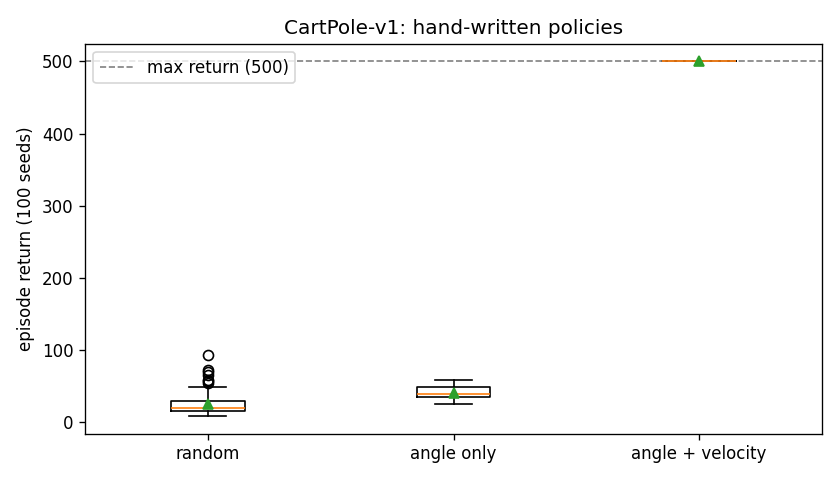

# Module 0 write-up

## Predictions (fill in before writing or running any code)

Mean return over 100 episodes (max 500):

| Policy | My prediction | Why |
|---|---|---|
| random | | |
| angle only | | |
| angle + velocity | | |

## Results

Paste the summary table from `run_experiment.py` and include `results.png`.

## Questions

1. How close were your predictions? Where were you furthest off, and what did you misjudge?
2. **Ablation:** why does the angle-only policy fail? Describe what the cart and pole are physically doing when it loses.
3. What value of k (or other rule) did you choose, and how did you pick it? What happens if k is much too large or much too small?
4. Does your policy ever fail? If so, what ends the episode: the pole falling or the cart leaving the track? (Hint: print the final observation.) If it never fails, raise `max_episode_steps` to 5,000 with `gym.make("CartPole-v1", max_episode_steps=5000)` and check again. What would you change to fix a failure?
5. Your policy was written by hand from physical intuition. Name one reason this approach won't scale to harder problems, which is why the rest of the course is about learning policies instead.
